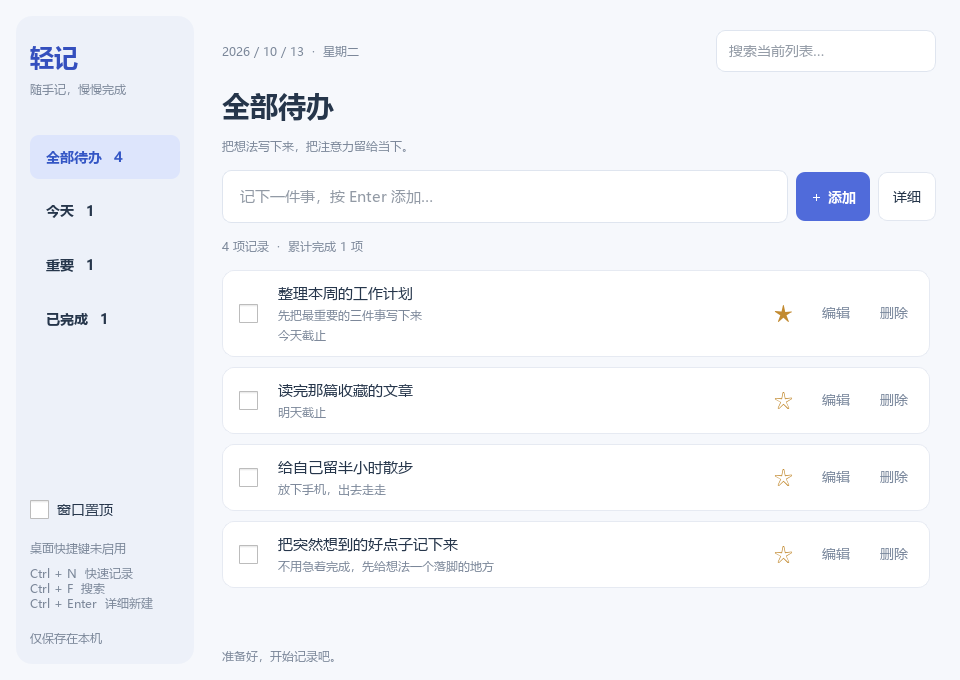

# 轻记 · 待办

独立的 PySide6 桌面待办工具。界面为简洁浅色风格，支持快速记录、本地自动保存、系统托盘和窗口置顶。无需账号或网络。



## 启动

当前机器已有 Python 3.8 和 PySide6 6.6.3.1，双击本目录的 **start.bat** 即可启动。也可以从项目根目录执行：

```powershell
python .\quick_todo\app.py
```

新环境推荐 Python 3.10 或更新版本。在本目录执行以下命令，创建独立环境：

```powershell
python -m venv .venv
.\.venv\Scripts\python.exe -m pip install -r requirements.txt
.\.venv\Scripts\python.exe app.py
```

启动脚本优先使用本目录虚拟环境，否则使用系统 Python；使用 pythonw 避免常驻控制台。Python 3.8 环境可安装 `PySide6==6.6.3.1`。

## 日常使用

- 输入一件事，按 **Enter** 或点击“添加”；点击“详细”补充备注、截止日期和重要标记。
- 勾选任务即可完成；在“已完成”列表取消勾选即可重新打开。
- 点击星号标为重要，点击“编辑”修改所有内容。
- “今天”包含今天到期和已逾期的未完成事项；在这里快速新增默认今天截止。在“重要”中新增默认标星。
- 搜索匹配当前列表中的标题和备注。排序为重要优先、截止日期优先、同等条件下新记录优先。
- 删除后点击底部“撤销删除”，可恢复最近一次删除，退出后不保留撤销记录。
- 勾选左下角“窗口置顶”，切换其他应用时仍可看到待办。
- 支持托盘的系统中，关闭窗口会隐藏到托盘，点击托盘图标重新打开，右键选择“退出”彻底退出。没有托盘时关闭窗口直接退出。
- 同一数据目录只允许运行一个实例。重复启动时会提示从托盘打开已有窗口。

**桌面全局快捷键：Ctrl+空格。** 先启动轻记，之后在桌面或其他普通应用中按下，即可唤醒窗口并聚焦快速记录输入框，输入后按 Enter 保存。左右 Ctrl 均支持。窗口隐藏到托盘或最小化时同样有效；唤醒会切回全部待办并清除搜索条件，保留尚未写完的输入。若正在编辑弹窗中，则回到弹窗，保留编辑内容。长按只唤醒一次。

轻记运行期间接管 Ctrl+空格；如果输入法或其他应用也使用这组按键，其原有功能在接管期间不会触发，彻底退出轻记后恢复。不会修改注册表或系统输入法配置。Win+空格不再用于唤醒轻记；其他按键和额外带 Alt/Shift/Win 的组合保持原有行为。快捷键未启用时，左下角和状态栏会提示，仍可点击托盘打开。程序未运行时无法唤醒，当前没有开机自启动。系统安全桌面、提权窗口和其他拦截快捷键的软件可能限制此功能。

应用内快捷键：**Ctrl+N** 聚焦快速记录、**Ctrl+F** 搜索、**Ctrl+Enter** 详细新建。

截止日期用于列表提示，不包含定时弹窗、开机自启动或云同步。

## 数据与图标

第一次启动后，数据保存在本目录的 `data/` 中：

- `tasks.sqlite3`：待办数据库，操作成功即提交保存。
- `settings.ini`：窗口位置、大小、置顶等设置。
- `app.log`：错误日志。
- `app.lock`：运行期间的实例锁。

备份前从托盘退出程序，然后复制整个 `data/` 文件夹。恢复时同样先退出，再放回备份文件。默认路径与启动时的工作目录无关。可用 `python app.py --data-dir D:\MyTodos` 指定数据目录。此工具使用独立数据库，不会自动导入旧 `todo_list` 数据。

**不必提供 Logo。** 内置图标可直接使用。如需自定义，只需将一张应用图标放到 `assets/icons/`，命名为 `app.ico`、`app.png` 或 `app.svg`；优先顺序也是如此。PNG 推荐 256×256 透明底；ICO 推荐包含多种尺寸。详情见 [素材说明](assets/icons/README.md)。

## 代码结构

```text
quick_todo/
  app.py                 # 组合入口：注入依赖、实例锁、启动/退出
  start.bat              # Windows 双击启动
  requirements.txt
  assets/icons/          # 可选应用 Logo
  todo/
    domain.py            # 不可变任务模型和仓储接口，无 Qt/数据库依赖
    service.py           # 验证、搜索、排序、任务业务，只依赖领域接口
    storage.py           # SQLite 仓储实现，事务持久化
    global_hotkey.py      # Windows 全局快捷键与独立消息线程，通过信号唤醒界面
    ui/
      window.py          # 主窗口、导航与托盘，使用注入的业务服务
      task_card.py       # 任务卡片，通过 Qt 信号报告用户操作
      editor.py          # 新增/编辑表单
      theme.py           # 集中式界面样式
      icons.py           # 素材加载与内置图标
  tests/                 # 业务、持久化、实际 Qt 交互测试
```

界面不直接访问 SQL，业务层不依赖 Qt；替换存储时实现 `TaskRepository` 并在 `app.py` 注入即可。数据存储使用同步本地事务，不引入额外框架。

全局快捷键是独立的 Windows 适配器：使用 `WH_KEYBOARD_LL` 在专用消息线程上识别并拦截 Ctrl+空格，避免该组合键继续传给输入法。回调只识别组合键并发送 Qt 信号，不记录输入内容、不模拟按键、不访问数据库或操作界面；退出时释放钩子。参考 [低级键盘钩子](https://learn.microsoft.com/en-us/windows/win32/winmsg/lowlevelkeyboardproc)。

## 验证

在本目录运行，测试使用临时数据库，不触碰真实待办：

```powershell
python -m unittest discover -s tests -v
```

可通过 `--smoke-test --data-dir <临时目录>` 验证完整启动链路，窗口短暂出现后自动退出。无屏幕环境可设置 `QT_QPA_PLATFORM=offscreen`。
